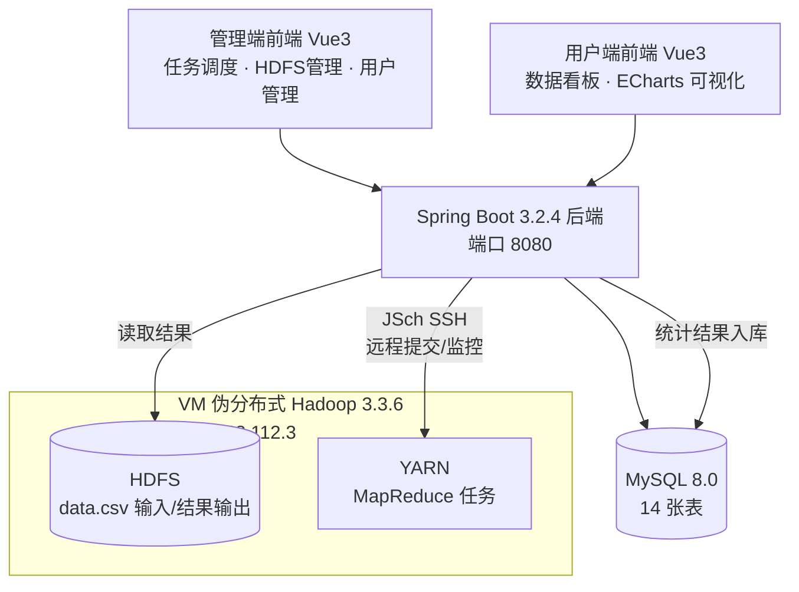

# 🛒 电商平台用户行为实时分析与转化路径

> 基于 **Hadoop MapReduce + Spring Boot + Vue 3** 的电商用户行为大数据分析系统：MapReduce 离线计算 + 后端远程调度 + 双前端可视化，处理 **10 万条用户行为记录（59 万次事件）**。

## 技术栈

| 组件 | 版本/说明 |
|---|---|
| Hadoop | 3.3.6（VM 伪分布式：HDFS + YARN） |
| MapReduce | 4 类自定义任务（基础指标 / 多维分析 / 转化漏斗 / 新老对比） |
| 后端 | Spring Boot 3.2.4 · MyBatis-Plus 3.5.5 · JWT · **JSch SSH 远程调度 Hadoop** |
| 前端 | Vue 3 + Vite · Element Plus · ECharts 5（管理端 + 用户端双前端） |
| 数据库 | MySQL 8.0（14 张表） |

## 系统架构



## 核心功能

### MapReduce 任务（4 类）

| 任务 | 统计内容 |
|---|---|
| Task1 基础指标 | PV / UV / 加购数 / 支付数 / 转化率 / 跳出率 / 新用户占比 |
| Task2 多维分析 | 5 维度（年龄 / 性别 / 设备 / 来源 / 操作系统）UV、PV、转化率 |
| Task3 转化漏斗 | view → cart → checkout → purchase 四步漏斗转化率与流失率 |
| Task4 新老对比 | 新老用户 UV、转化率、客单价等对比指标 |

### 后端接口

认证（JWT）、用户管理、任务管理（提交/查询/重试/删除 MR 任务）、基础指标、多维分析、漏斗分析、用户对比、**HDFS 文件管理**（目录浏览/上传/删除）。

### 测试数据

`data.csv`：100,000 条用户行为记录，590,749 次总事件。参考结果：PV=590,749、UV=100,000、转化率 ≈58.9%、跳出率 ≈18.3%、新用户占比 ≈30%。

## 快速启动（概要）

```bash
# 1. 初始化数据库（14 张表 + 默认账号）
mysql -u root -p < database/schema.sql
mysql -u root -p < database/init-data.sql

# 2. VM 启动 Hadoop（HDFS + YARN，jps 验证进程）
start-dfs.sh && start-yarn.sh

# 3. 打包 MR 程序并上传 VM（后端会通过 JSch 自动调度）
cd mapreduce && mvn clean package -DskipTests
scp target/ecommerce-mapreduce-1.0.0.jar hadoop@192.168.112.3:/home/hadoop/

# 4. 启动后端 + 双前端
cd backend && mvn spring-boot:run        # http://localhost:8080/api
cd frontend && npm run dev                # 管理端 http://localhost:5173
cd frontend-user && npm run dev           # 用户端 http://localhost:5174
```

默认账号：`admin / admin123`（管理员）、`user001 / user123`（普通用户）。

## 项目难点与解决（3 个精选）

### 1️⃣ MapReduce 任务参数错位（Usage 报错）
执行 `hadoop jar xxx.jar ClassName /input /output` 时提示 Usage 错误——args 长度为 3 而非 2。

**根因**：`pom.xml` Shade 插件配置了 `<mainClass>`，Hadoop 把 JAR 的 Main-Class 当作入口，命令行里的 `ClassName` 被当成 `args[0]`。

**解决**：Shade 插件不设置 mainClass，Driver 的 `main()` 不经过 `ToolRunner` 包装，直接 `driver.run(args)`，恢复标准两参数调用。

### 2️⃣ SSH 远程调度找不到 hadoop 命令
后端通过 JSch 执行 `hadoop jar ...` 返回 `hadoop: command not found`。

**根因**：SSH 非交互式登录不加载 `~/.bashrc` / `/etc/profile`，`HADOOP_HOME/bin` 不在 PATH。

**解决**：执行命令前显式 `source /etc/profile && source ~/.bashrc 2>/dev/null`，再拼接原始命令。

### 3️⃣ BCrypt 密码哈希伪造导致登录失败
`init-data.sql` 中 password 字段是占位字符串而非真实 BCrypt 哈希，`BCryptPasswordEncoder.matches()` 永远返回 false，`admin123` 登录必败。

**解决**：用真实生成的 BCrypt 哈希替换（`UPDATE sys_user SET password = '$2a$10$...'`），并同步更新 init-data.sql 保证可重复执行。

## 完整踩坑与排错记录（11 条）

| # | 问题 | 解决方案 |
|---|---|---|
| 1 | MR JAR mainClass 参数错位 | Shade 不设 mainClass，main() 直接 driver.run(args) |
| 2 | MyBatis-Plus create_time cannot be null | 注册 `MetaObjectHandler` 自动填充 |
| 3 | ECharts "chart already initialized" | init 前先 `getInstanceByDom` 判断并 dispose |
| 4 | el-radio label 弃用警告 | 改用 `:value` 绑定 |
| 5 | ElTag type="" 非法 prop | 补全 job_type 映射，fallback 用合法值 'info' |
| 6 | 多维度"操作系统"维度无数据 | 核对数据集中 os 字段与 Mapper 提取逻辑 |
| 7 | SSH 执行找不到 hadoop 命令 | 命令前 source /etc/profile 和 ~/.bashrc |
| 8 | init-data.sql 伪造 BCrypt 哈希 | 替换为真实哈希 |
| 9 | 路由守卫拦截系统管理菜单 | 登录后把 roles 合并进 userInfo 再存 localStorage |
| 10 | PageResult 空列表除零崩溃 | 构造函数对 size==0 短路处理 |
| 11 | 管理端趋势图空白 | 改用取最近 n 条记录接口，不依赖固定日期范围 |

## 演示视频

[demo/demo.mp4](demo/demo.mp4) — 系统完整演示（已压缩至 GitHub 可上传大小，原视频 361MB）。

## 目录结构

```
ecommerce-analysis/
├── database/           # schema.sql（14 张表）+ init-data.sql（默认账号）
├── mapreduce/          # Hadoop MapReduce 程序（4 个任务，独立 Maven 项目）
├── backend/            # Spring Boot 3.2.4 后端（JSch 调度、任务管理、统计接口）
├── frontend/           # 管理端前端（任务调度 / HDFS 管理 / 用户管理）
├── frontend-user/      # 用户端前端（数据看板 / ECharts 可视化）
└── demo/               # 演示视频
```

## 许可证

本项目仅用于课程设计与学习用途。
